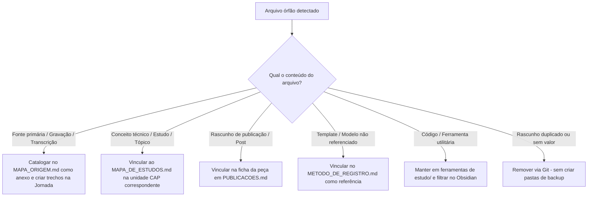

# Governança de Contexto e Conexões no Obsidian

Esta skill orienta autores e agentes na utilização das ferramentas visuais e estruturais do **Obsidian** para identificar falhas de contexto, notas órfãs (desconectadas) e referências pendentes no projeto editorial.

Ela assegura que o grafo de conhecimento represente a arquitetura editorial real, respeitando as regras do [AGENTS](../../../AGENTS.md) e evitando poluição, conexões artificiais ou acúmulo de notas soltas.

---

## 1. Princípio Editorial de Conexão

No Obsidian, um grafo conectado só tem valor se as conexões forem **significativas**. Não se deve criar links apenas para "sumir com os nós órfãos" do gráfico.

Toda conexão deve responder a uma das 4 perguntas:
1. **É evidência ou fato biográfico?** Deve ancorar em um episódio da [Jornada do Herói](<../../../registro da autoridade/Template jornada do heroi/README.md>) ou no [Mapa de Origem](<../../../registro da autoridade/Template jornada do heroi/MAPA_ORIGEM.md>).
2. **É conceito técnico ou lição de engenharia?** Deve ancorar em uma unidade de estudo no [Mapa de Estudos](<../../../capitulos estudos/MAPA_DE_ESTUDOS.md>).
3. **É peça editorial ou rascunho de publicação?** Deve constar no [Índice de Publicações](<../../../registro da autoridade/PUBLICACOES.md>) com sua ficha de acompanhamento.
4. **É decisão ou planejamento de fluxo?** Deve constar na iniciativa SDD pertinente em [Spec Editorial](<../../../spec editorial/README.md>).

Se o arquivo não se encaixa em nenhuma das 4 categorias, ele pode ser um **anexo utilitário** (ferramenta externa) ou um **rascunho descartável** que deve ser saneado.

---

## 2. Diagnóstico no Obsidian (Ferramentas Nativas)

### A. Graph View (Grafo Global)
O Grafo Global mostra a topologia completa do cofre. Para torná-lo legível e produtivo:

1. **Isolar ruído de ferramentas:**
   - Adicione no filtro de busca do Grafo: `-path:"ferramentas de estudo"`
   - *Motivo:* Pastas de repositórios/ferramentas externas (como `VagasAutomatizado` ou kits de código) contêm dezenas de arquivos que poluem a visão editorial.
2. **Colorir por áreas (Color Groups):**
   - Grupo 1 (Jornada): `path:"registro da autoridade/Template jornada do heroi"` (verde)
   - Grupo 2 (Estudos/Livro): `path:"capitulos estudos"` (azul)
   - Grupo 3 (Publicações): `path:"registro da autoridade"` (laranja)
   - Grupo 4 (SDD / Governança): `path:"spec editorial"` (roxo)
3. **Filtrar nós críticos:**
   - **Orphans (Órfãos):** Ative para inspecionar nós sem arestas (arquivos isolados).
   - **Not-created / Unresolved:** Ative para ver notas que foram linkadas no texto, mas cujos arquivos nunca foram criados (promessas de contexto não cumpridas).

---

### B. Local Graph (Grafo Local)
Em vez de analisar todo o acervo de uma vez, use o Grafo Local nos **Mapas de Conteúdo (MOCs)**:
- Abra [`MAPA_DE_ESTUDOS.md`](<../../../capitulos estudos/MAPA_DE_ESTUDOS.md>), [`UNIVERSO_NARRATIVO.md`](<../../../registro da autoridade/Template jornada do heroi/UNIVERSO_NARRATIVO.md>) ou [`PUBLICACOES.md`](<../../../registro da autoridade/PUBLICACOES.md>).
- Na paleta de comandos (`Ctrl + P`), execute: `Open local graph`.
- Configure **Depth (Profundidade)** para `2` ou `3`.
- Inspecione se os arquivos que deveriam pertencer àquela área estão orbitando o mapa central. Se algum arquivo estiver ausente dessa teia, ele está isolado.

---

### C. Unlinked Mentions (Menções Não Vinculadas)
Recurso essencial para converter citações textuais em conexões estruturais:
1. Abra um nó de autoridade (ex: uma nota de conceito técnico, metodologia SDD, ou fonte).
2. Abra o painel lateral direito e clique na aba **Backlinks**.
3. Expanda **Unlinked mentions** (Menções não vinculadas).
4. O Obsidian lista todas as outras notas que citam esse nome/termo sem o colchete `[[...]]`.
5. Avalie caso a caso e clique no botão **Link** para oficializar o vínculo se houver relevância editorial.

---

### D. Buscas Avançadas de Isolamento no Obsidian Search
Execute na barra de pesquisa do Obsidian (`Ctrl + Shift + F`):

| Objetivo | Sintaxe de Busca |
| :--- | :--- |
| **Buscar notas sem nenhum link** | `-[[ -[ -path:"ferramentas de estudo"` |
| **Buscar notas de estudo fora do mapa** | `path:"capitulos estudos" -file:"MAPA_DE_ESTUDOS.md"` |
| **Identificar tarefas editoriais pendentes** | `path:"spec editorial" /\[ \] PENDENTE/` |
| **Localizar referências a um anexo bruto** | `file:"origem.md" ou content:"origem.md"` |

---

## 3. Matriz de Tratamento de Arquivos Soltos

Ao identificar um arquivo órfão ou desconectado durante a auditoria:

---

## 4. Checklist Periódico de Sanidade do Cofre

Execute este checklist ao final de cada iniciativa SDD ou antes de iniciar a redação de um novo capítulo:

- [ ] **Filtro de órfãos checado:** Nenhuma nota de publicação ou estudo relevante está flutuando sem link de entrada.
- [ ] **Links não resolvidos conferidos:** Não há links apontando para arquivos inexistentes sem justificativa de backlog.
- [ ] **Fontes primárias ancoradas:** Transcrições e anotações brutas (como `origem.md`) estão explicitamente catalogadas no `MAPA_ORIGEM.md`.
- [ ] **Esboços e fichas pareados:** Todo esboço de post (ex: `esboco.md`) possui ligação direta com sua respectiva `ficha.md` e com `PUBLICACOES.md`.
- [ ] **Exclusão de ruído mantida:** O arquivo de configuração do grafo ou as buscas filtram subprojetos de `ferramentas de estudo/`.

